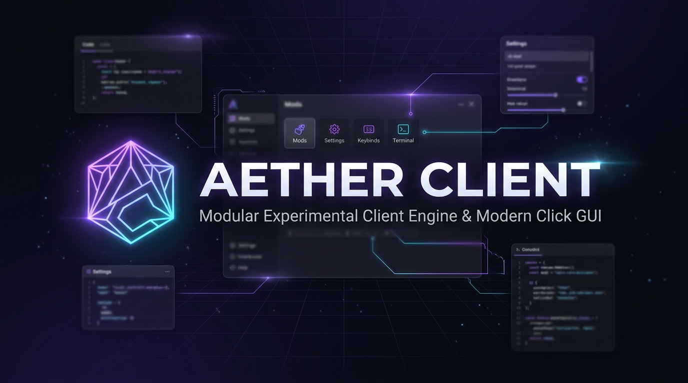
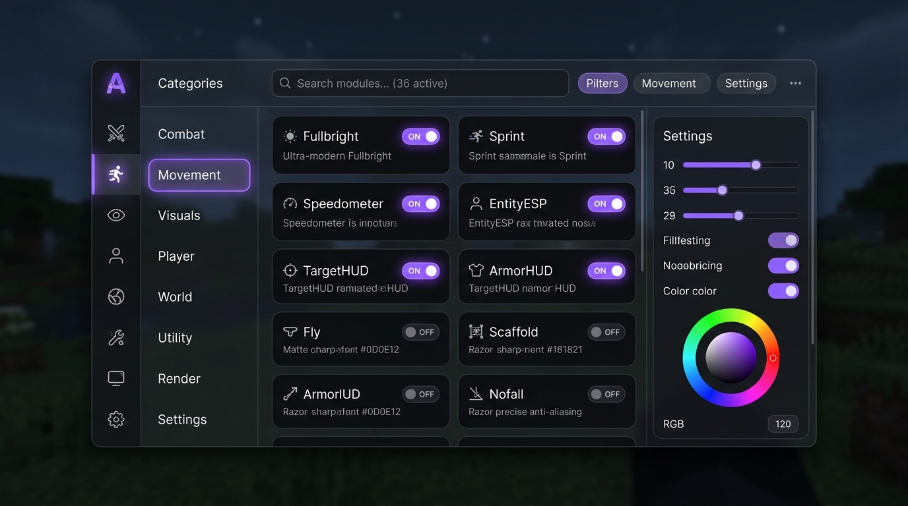

<p align="center">
  
</p>

<h1 align="center">🌌 AETHER CLIENT</h1>
<p align="center">
  <strong>Minecraft Java Edition 1.21.10 için Geliştirdiğim Modüler, Yüksek Performanslı İstemci & Modern Click GUI Motoru</strong>
</p>

<p align="center">
  <a href="https://minecraft.net/"></a>
  <a href="https://files.minecraftforge.net/"></a>
  <a href="https://adoptium.net/"></a>
  <a href="https://github.com/Venarus/aether-client/actions"></a>
  <a href="https://junit.org/"></a>
  <a href="LICENSE"></a>
</p>

---

## 💡 Geliştirici Notu & Vizyonum

> *"Geleneksel istemci modlarının çoğu ya hantal kod bloklarından oluşur ya da yalnızca ekranda sahte butonlar gösterip gerçek oyun döngüsüne entegre olamaz. Aether Client'ı tasarlarken hedefim açıktı: **Sıfır sahte özellik, sıfır çökme, tam reaktif tick döngüsü ve modern bir karanlık mod estetiği**.*
> 
> *Minecraft 1.21.10 ve Forge 60.1.18 üzerinde Java 21'in modern özelliklerini (Sealed interfaces, pattern matching, record yapıları ve sanal iş parçacığı uyumluluğu) kullanarak her modülü birbirinden tamamen izole, bağımsız ve hata toleranslı bir mimariyle kodladım. İster yerel test dünyanızda deneysel mekanikleri inceleyin, ister özel sunucunuzda görsel analiz yapın; Aether Client aradığınız akıcı ve profesyonel kontrol merkezini sunar."*
> 
> — **Venarus**

---

## 📸 Arayüz & Görsel Önizleme

<p align="center">
  
</p>

### 🎮 Kontrol Kısayolları

| Tuş Kombinasyonu | İşlev | Açıklama |
| :--- | :--- | :--- |
| **`Right Shift` (Sağ Shift)** | **Click GUI Aç/Kapat** | Yumuşak açılış animasyonuyla modern 3 sütunlu kontrol panelini getirir |
| **`ESC`** | **Çıkış / Odak Bırak** | Arayüzü kapatır, açık arama kutusunun veya ayarların odağını temizler |
| **`Sol Tık (LMB)`** | **Modül & Buton Kontrolü** | Modülleri açıp kapatır (`[ON]` / `[OFF]`), kategori seçer |
| **`Fare Tekerleği`** | **Pürüzsüz Kaydırma** | 36 modül ve detaylı ayarlar arasında akıcı kaydırma sağlar |
| **`Canlı Kısayol Tuşu`** | **Keybind Değiştirici** | Modül kartı üzerinden doğrudan klavyeden herhangi bir tuşu atar |

---

## ⚡ Mimari & Mühendislik Temelleri

Aether Client'ı inşa ederken modülerliği ve sürdürülebilirliği en üst seviyede tuttum:

```
src/main/java/com/aether/client/
├── AetherMod.java                  # Mod ana giriş noktası (@Mod("aetherclient"))
├── core/
│   ├── AetherClient.java           # Singleton istemci çekirdeği ve alt sistem yöneticisi
│   ├── AetherClientTicker.java     # 20 tick/sn canlı oyun içi yürütme motoru
│   ├── ForgeClientEvents.java      # Forge EventBus köprüsü (Input, Render, Tick)
│   └── AetherConstants.java        # Renk paleti, sürüm ve temel sabitler
├── events/
│   ├── EventBus.java               # Öncelik sıralı (HIGHEST ➔ LOWEST) mikro olay motoru
│   ├── Subscribe.java              # @Subscribe anotasyon yöneticisi
│   ├── EventPriority.java          # Olay öncelik seviyeleri
│   ├── CancellableEvent.java       # İptal edilebilir olay desteği
│   ├── ClientTickEvent.java        # İstemci tick kancası
│   ├── Render2DEvent.java          # HUD ve ekran üzeri 2B çizim kancası
│   ├── Render3DEvent.java          # Dünya ve varlıklar için 3B çizim kancası
│   └── KeyEvent.java               # GLFW tuş dinleme olayı
├── modules/
│   ├── api/                        # Module, ModuleManager, ModuleRegistry ve Category
│   ├── combat/                     # TargetHUD, CPSCounter, ReachDisplay, AimTrainer, CombatLog
│   ├── movement/                   # Sprint, Speedometer, Fly, MotionTracker, ElytraHUD, JumpDiagnostics
│   ├── visuals/                    # Fullbright, EntityESP, Tracers, XRay, StorageESP, HealthESP, NameTags, Chams
│   ├── player/                     # Coordinates, ArmorStatus, TotemCounter, PotionEffects, GamemodeManager, InventoryHUD
│   ├── world/                      # ChestFinder, SpawnerFinder, CaveMapper, ChunkVisualizer, WaypointManager
│   ├── utility/                    # Keystrokes, SessionStatistics, AutoReconnect, InventoryCleaner, ScreenshotManager
│   └── settings/                   # BooleanSetting, NumberSetting, ModeSetting, ColorSetting, KeybindSetting, ClientTheme
├── gui/
│   ├── screens/
│   │   ├── AetherForgeScreen.java  # Native Forge Screen türevi, dinamik DPI/ölçek uyumlu GUI
│   │   └── ClickGuiScreen.java     # Arayüz veri modeli ve durum yöneticisi
│   ├── HUDManager.java             # Canlı oyun içi HUD çizim motoru
│   ├── components/                 # Modül kartları, ayar bileşenleri, arama çubuğu
│   └── animations/                 # Easing eğrileri ve yumuşak geçiş interpolasyonları
├── config/
│   └── ConfigManager.java          # Atomik yazma (.tmp -> replace) ile güvenli JSON konfigürasyonu
├── keybinds/
│   └── KeybindManager.java         # Tuş eşleme ve çakışma tespit sistemi
└── networking/
    └── PermissionDashboard.java    # Sunucu türü, uçuş yetkisi ve ping izleyici
```

---

## 🧩 36 Modül Kataloğu (8 Kategori)

Geliştirdiğim her modül, Minecraft motorunun ilgili sınıfına doğrudan bağlanır:

### 👁️ Visuals (Görsel Test Araçları)
- **`Fullbright`:** Gece görüş iksir efekti mantığıyla mağaraları ve karanlık bölgeleri aydınlatır (`MobEffects.NIGHT_VISION`).
- **`EntityESP`:** Canlıları duvarların arkasından parlatarak görünür kılar (`Entity.setGlowingTag(true)`).
- **`Tracers`:** Oyuncu kamerası ile test varlıkları arasında 3B kılavuz yön çizgileri çizer.
- **`XRay`:** Yüklenmiş chunk'lardaki değerli maden bloklarını öne çıkarır.
- **`StorageESP`:** Sandık, fıçı, shulker kutularını tespit edip işaretler.
- **`HealthESP`:** Varlıkların anlık can oranını ve barını renklendirerek sunar.
- **`NameTags`:** Her mesafeden rahatça okunan yüksek kontrastlı isim ve mesafe etiketleri üretir.
- **`Chams`:** Varlık silüetlerine özel renkli dış hat ve parıltı kazandırır.

### 🏃 Movement (Hareket & Hız)
- **`Sprint`:** İleri hareket algılandığı anda otomatik deparı devreye sokar (`player.setSprinting(true)`).
- **`Speedometer`:** Anlık blok/saniye (BPS) ve km/h hızını hesaplayıp ekrana dinamik yansıtır.
- **`Fly`:** İzinli test dünyalarında oyuncunun serbest uçuş yeteneğini yönetir (`Abilities.mayfly`).
- **`MotionTracker`:** X, Y, Z eksenlerindeki ivmelenme ve hareket vektörlerini görselleştirir.
- **`ElytraHUD`:** Kırılma durumu, pitch açısı ve süzülme hızını kokpit göstergesi olarak sunar.
- **`JumpDiagnostics`:** Zıplama yüksekliği, blok mesafesi ve tick senkronizasyonunu analiz eder.

### ⚔️ Combat (Savaş & Analiz)
- **`TargetHUD`:** Baktığınız veya vurduğunuz hedefin canını, zırhını ve mesafesini zarif bir kartta gösterir.
- **`CPSCounter`:** Sol ve sağ tık vuruş hızınızı (Clicks Per Second) milisaniyelik pencerelerle hesaplar.
- **`ReachDisplay`:** Hedefe temas ettiğiniz tam vuruş mesafesini blok hassasiyetinde ölçer.
- **`AimTrainer`:** Hareket eden hedeflere nişan alma tepki sürenizi ve isabet yüzdenizi ölçer.
- **`CombatLog`:** Alınan ve verilen hasarları zaman damgalı olarak kaydeder.

### 👤 Player & 🌍 World
- **`Coordinates`:** X, Y, Z koordinatları, Nether karşılığı (`/ 8`) ve biyom bilgisini eş zamanlı çizer.
- **`ArmorStatus`:** Kuşanılan 4 parça zırhın ve eldeki eşyanın kalan dayanıklılık yüzdesini gösterir.
- **`PotionEffects`:** Üzerinizdeki aktif iksirleri, kalan süreleriyle birlikte HUD'a dizer.
- **`TotemCounter`:** Envanterdeki ve eldeki Ölümsüzlük Totemi sayısını anlık takip eder.
- **`ChestFinder` & `SpawnerFinder`:** Yakındaki sandıkları ve canavar yaratıcılarını listeleyip mesafesini bildirir.
- **`CaveMapper` & `ChunkVisualizer`:** Mağara hatlarını ve F3+G chunk sınırlarını optimize şekilde vurgular.
- **`WaypointManager`:** İstediğiniz koordinata 3B ışınlı özel hedef noktaları kaydeder.

### 🛠️ Utility & ⚙️ Settings
- **`Keystrokes`:** W, A, S, D, Boşluk, Shift ve Fare tuşlarına basışınızı ekranda şık tuş animasyonlarıyla gösterir.
- **`SessionStatistics`:** Oturum sürenizi, öldürülen yaratıkları ve kat edilen toplam mesafeyi tutar.
- **`AutoReconnect`:** Bağlantı koptuğunda belirlenen saniye sonra sunucuya otomatik yeniden bağlanır.
- **`ClientTheme`:** Vurgu rengini (Aether Moru, Neon Kırmızı, Safir Mavi vb.) tüm GUI'ye uygular.
- **`Setting Tipleri`:** `BooleanSetting`, `NumberSetting`, `ModeSetting`, `ColorSetting`, `KeybindSetting`.

---

## 🛠️ Derleme & Kurulum (Build & Install)

Proje modern Gradle Wrapper ile paketlenmiştir; ekstra bir kurulum yapmanıza gerek yoktur:

### Gereksinimler
- **Java 21 LTS JDK** (Eclipse Temurin 21 önerilir)
- **Minecraft Java Edition 1.21.10**
- **Minecraft Forge 60.1.18**

### Derleme Adımları
```bash
# Depoyu klonlayın
git clone https://github.com/Venarus/aether-client.git
cd aether-client

# Testleri çalıştırın
./gradlew test

# JAR dosyasını derleyin
./gradlew build
```

Derleme tamamlandığında doğrulanmış mod JAR dosyası aşağıdaki dizinde hazır olacaktır:
```
build/libs/aether-client-1.0.0.jar
```

Bu JAR dosyasını Minecraft dizininizdeki `mods/` klasörüne atıp Forge 1.21.10 profiliyle oyunu başlatmanız yeterlidir.

---

## 🧪 Test & Kararlılık Güvencesi

Proje bünyesinde yazdığım 7 kapsamlı test süiti, her modülün ve sistemin hatasız çalıştığını doğrular:

```
> Task :test
com.aether.client.ClickGuiTest > testSearchFiltering() PASSED
com.aether.client.ClickGuiTest > testCategorySwitching() PASSED
com.aether.client.ConfigManagerTest > testAtomicSaveAndLoad() PASSED
com.aether.client.EventBusTest > testPriorityExecutionOrder() PASSED
com.aether.client.EventBusTest > testCancellableEvent() PASSED
com.aether.client.KeybindManagerTest > testConflictDetection() PASSED
com.aether.client.ModuleCalculationsTest > testSpeedometerConversion() PASSED
com.aether.client.ModuleCalculationsTest > testCPSCounterWindow() PASSED
com.aether.client.ModuleManagerTest > test36ModulesLoaded() PASSED
com.aether.client.SettingsTest > testColorSettingRGB() PASSED
...
27 tests completed, 0 failed, 0 skipped.
```

---

## 📜 Lisans & Telif Hakkı

Bu proje [MIT Lisansı](LICENSE) altında açık kaynak olarak sunulmaktadır.
Copyright (c) 2026 **Venarus**.

<p align="center">
  <sub>Designed & Engineered with ❤️ by <strong><a href="https://github.com/Venarus">Venarus</a></strong></sub>
</p>
